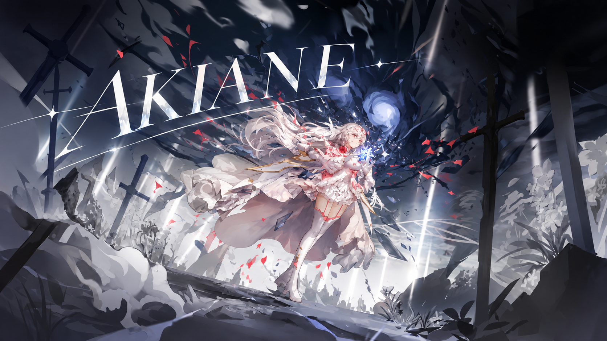
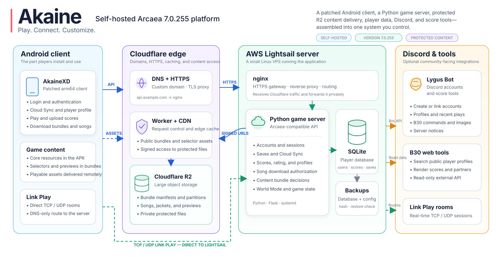

# Akaine 7.0.255

English | [Tiếng Việt](README.vi.md)

  
  
  
  
   
  
  
  
  

  <strong><a href="https://github.com/quanq026/akaine/releases/latest">Download APK</a></strong> ·
  <a href="docs/guide/README.md">Start the guide</a> ·
  <a href="https://discord.gg/9BBXhX7DkN">Discord</a>

Akaine is a setup guide and public source repository for a server and Android
client based on Arcaea 7.0.255. The guide starts with a clean Windows computer
and a new cloud account. You do not need previous experience with Linux,
Cloudflare or Android builds.

The guide and public client patches target only version `7.0.255` with version
code `1209852`. Older and newer Arcaea releases use different files and native
offsets, so they are outside this repository's instructions.

The repository contains the guide, server and build tools. Download the
original client from APKPure; matching content and chart-key inputs are
supplied separately when the guide needs them.

## Features

### Server

| Feature | Supported capabilities |
| --- | --- |
| Accounts | Registration, login, sessions and login/registration rate limits. |
| Scores and Potential | Score submission/checks, play history, Best 30, Recent 10 and chart rankings. |
| Friends | Friend lists, adding/removing friends and score comparisons. |
| Cloud Sync | Upload/download of saves and shared content-unlock policies. |
| World Mode | Maps, stamina, progression and rewards. |
| Characters | Ownership, levels, awakening and supported partner skills. |
| Course Mode | Course progression, results and completion rewards. |
| Songs and packs | Dynamic catalogue, song/pack ownership and unlocks using in-game currency. |
| Gifts and missions | Presents, redeem codes and basic beginner missions. |
| Content delivery | In-game bundle updates, per-song downloads, download checks and AKFC-encrypted charts. |
| Administration | Web admin, permission-based API, account/content tools and score/Potential logs. |
| Discord bot | Account creation/linking, profiles, recent plays, B30 images and player rankings. |

**Support notes:** World Mode boosts and some partner skills may differ from the
official game. Link Play room/matchmaking code is included, but requires separate
setup and client compatibility verification.

Setup: [game server](docs/guide/05a-install-game-server.md) ·
[Discord bot](docs/guide/05b-discord-bot.md) ·
[content bundles](docs/guide/07-build-release-content-bundle.md).

### Android client

| Feature | Supported capabilities |
| --- | --- |
| Native fan charts | Custom charts played through the native game engine, including AKFC-encrypted charts. |
| Mod library | A dedicated category for custom content and an expandable pack catalogue. |
| Song selection | Search, difficulty selection, sorting, grouping and filters. |
| Characters and skills | Character selection, supported native skills and skill sealing. |
| Anomaly Replay | Enable or disable replay for supported native anomaly scenes. |
| Online services | Private-server login and Cloud Sync. |
| CLI over ADB | Read game state and operate menus, gameplay controls and recognized guides without coordinate clicks or image scanning. |
| Diagnostics | Native event logs, state inspection and log/screenshot export. |

Usage: [build the client](docs/guide/06-build-android-client.md) ·
[CLI commands](docs/guide/06a-semantic-cli.md) ·
[add a native fan chart](docs/guide/09-add-fan-chart.md).

**Compatibility:** Fan charts must use the supported native format; an ArcCreate
runtime is not included. CLI guide handling covers recognized steps.

## What you will build

By the end of the guide, you will have:

- a Linux server running on Amazon Lightsail
- a domain protected by Cloudflare
- a private-server API reachable over HTTPS
- a private resource store for bundles and song files
- a V36 Android client built from the original APKPure package
- a Discord bot for accounts and score tools
- a backup and recovery routine

## Before you start

Set aside an uninterrupted afternoon for the first setup. You need:

- a Windows 10 or Windows 11 computer with at least 30 GB free
- an Android phone or a computer capable of running an Android emulator
- a payment card accepted by AWS and your domain registrar
- an email address you control and can protect with two-factor authentication
- the private Akaine resource kit and its expected SHA-256 value

New AWS customers may receive up to USD 200 in credits for six months, enough
to cover the Lightsail server during the initial setup period. Vietnamese
citizens aged 18 to 23 may also qualify for one free `.id.vn` domain for two
years through participating `.vn` registrars such as iNET. Promotional domains
can start at roughly 40,000 VND, but check the renewal price before buying.

Cloudflare DNS, CDN and SSL use the Free plan. R2 includes 10 GB of Standard
storage each month, and extra storage costs USD 0.015 per GB-month. For a small
installation, the R2 bill is usually below USD 1 per month unless you keep many
duplicate releases or serve unusually heavy traffic.

When the AWS credits expire, you can pay for the same Lightsail server or move
the installation to another VPS provider.

## Start the guide

1. [See how the system works](docs/guide/01-architecture.md).
2. [Create the cloud server and connect a domain](docs/guide/02-cloud-domain.md).
3. [Prepare your Windows computer](docs/guide/03-workstation.md).
4. [Get and verify the private resource kit](docs/guide/04-private-resources.md).
5. [Configure R2](docs/guide/05-cloudflare-content.md), [install the game server](docs/guide/05a-install-game-server.md), [run the optional Discord bot](docs/guide/05b-discord-bot.md), and [set up backups](docs/guide/05c-backup-recovery.md).
6. [Build, sign and test the Android client](docs/guide/06-build-android-client.md).
7. [Build, verify and release a 7.0.255 content bundle](docs/guide/07-build-release-content-bundle.md).
8. [Learn from the failures encountered while building Akaine](docs/guide/08-lessons-and-failures.md).
9. [Add a fan chart and place it in a pack](docs/guide/09-add-fan-chart.md).

Start with chapter one and continue in order. Every later chapter assumes the
previous chapter's checks have passed.

## Private resources

Download the unmodified client from the APKPure link in chapter 6. Obtain the
matching content catalogue, AKFC inputs and game content privately from the
project owner or another authorized provider. The private kit includes a
manifest so you can verify every file before using it.

## Credits

Akaine credits
[Lost-MSth/Arcaea-server](https://github.com/Lost-MSth/Arcaea-server) as an
upstream reference for its server work.

## License and ownership

Akaine-owned source contributions are published under the MIT License.
Third-party code keeps its original license. The MIT License does not grant
permission to redistribute commercial game clients, music, charts, artwork or
other material owned by someone else.
