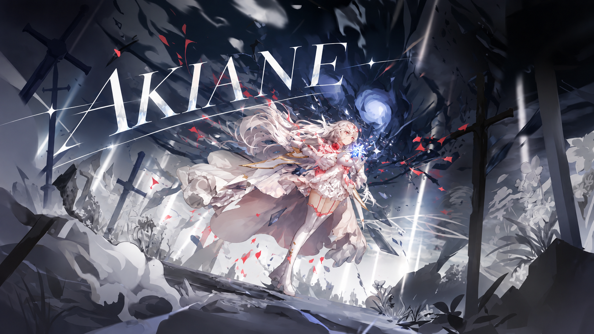
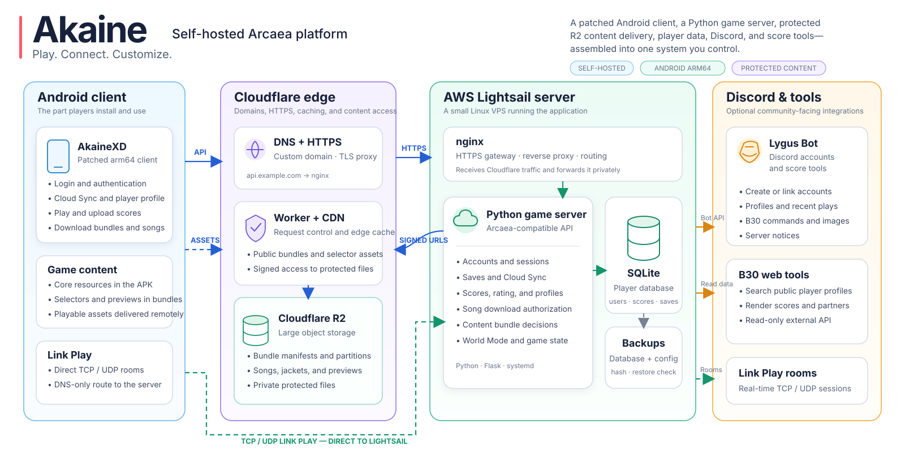

# Akaine 7.3.1

English | [Tiếng Việt](README.vi.md)

  
  
  
  
   
  
  
  

  <strong><a href="docs/guide/06-build-android-client.md">Prepare client files</a></strong> ·
  <a href="docs/guide/README.md">Start the guide</a>

Akaine provides public source and a beginner's guide for setting up a game server
and preparing the Android client inputs.

| What you want to do | Where to start |
| --- | --- |
| Prepare the original client | [Verify and merge Arcaea 7.3.1 ARM64](docs/guide/06-build-android-client.md) |
| Set up your own server | [Start from a clean machine](docs/guide/) |
| Browse the 7.3.1 port | [Native patches, Android bindings and CLI source](patches/arcaea-7.3.1-arm64/). The standalone 7.3.1 build is still pending. |

**Starting from scratch? Check these inputs before renting a VPS.**

1. **To prepare the stock client:** download the 7.3.1 ARM64 XAPK and follow the client chapter. The output is a stock `merged.apk`.
2. **To self-host:** obtain an authorized [prepared 7.3.1 content kit](docs/guide/04-private-resources.md). It must include the manifest, bundle parts, catalogue and individual song files.
3. **To play:** you need a patched, signed Akaine 7.3.1 APK configured for your hostname. This repo provides patch source and stock preparation. A complete public APK build command is pending.

## Features

### Server

| Feature | Supported capabilities |
| --- | --- |
| Accounts | Registration, login, sessions and login/registration rate limits. |
| Scores and Potential | Score submission/checks, play history, Best 50 Potential and chart rankings. |
| Friends | Friend lists, adding/removing friends and score comparisons. |
| Cloud Sync | Upload/download of saves and shared content-unlock policies. |
| World Mode | Maps, stamina, progression and rewards. |
| Characters | Ownership, levels, awakening and supported partner skills. |
| Course Mode | Course progression, results and completion rewards. |
| Songs and packs | Dynamic catalogue, song/pack ownership and unlocks using in-game currency. |
| Gifts and missions | Presents, redeem codes and basic beginner missions. |
| Content delivery | In-game bundle updates, per-song downloads, download checks and AKFC-encrypted charts. |
| Administration | Web admin, permission-based API, account/content tools and score/Potential logs. |
| Discord bot | Account creation/linking, profiles, recent plays, B30 images and player rankings. |

**Support notes:** World Mode boosts and some partner skills may differ from the
official game. Link Play room/matchmaking code is included, but requires separate
setup and client compatibility verification.

Setup: [game server](docs/guide/05a-install-game-server.md) ·
[Discord bot](docs/guide/05b-discord-bot.md) ·
[content bundles](docs/guide/07-build-release-content-bundle.md).

### Android client

| Feature | Supported capabilities |
| --- | --- |
| Native fan charts | Custom charts played through the native game engine, including AKFC-encrypted charts. |
| Mod library | A dedicated category for custom content and an expandable pack catalogue. |
| Song selection | Search, difficulty selection, sorting, grouping and filters. |
| Characters and skills | Character selection, supported native skills and skill sealing. |
| Anomaly Replay | Enable or disable replay for supported native anomaly scenes. |
| Online services | Private-server login and Cloud Sync. |
| CLI over ADB | Read game state and operate menus, gameplay controls and recognized guides without coordinate clicks or image scanning. |
| Diagnostics | Native event logs, state inspection and log/screenshot export. |

Usage: [build the client](docs/guide/06-build-android-client.md) ·
[CLI commands](docs/guide/06a-semantic-cli.md) ·
[add a native fan chart](docs/guide/09-add-fan-chart.md).

**Compatibility:** Fan charts must use the supported native format; an ArcCreate
runtime is not included. CLI guide handling covers recognized steps.

## What you will build

By the end of the guide, you will have:

- a Linux server running on Amazon Lightsail
- a domain protected by Cloudflare
- a private-server API reachable over HTTPS
- a private resource store for bundles and song files
- an original 7.3.1 Android input verified and merged from APKPure
- a Discord bot for accounts and score tools
- a backup and recovery routine

To connect a client to your server, supply a compatible APK built for your hostname; see [chapter 6](docs/guide/06-build-android-client.md).

## Repository layout

- [Android builder](akaine_build/) verifies the original package. [Versioned patches](patches/) contain the port source. Shared patch source lives in [patches/shared](patches/shared/).
- [Semantic CLI](akaine_cli/) operates an installed client.
- [Server](server/) serves the game API. Setup instructions are in [the guide](docs/guide/).

## Start the guide

- [Prepare the original Android package](docs/guide/06-build-android-client.md) if you already have the tools and build inputs.
- [Set up your own server](docs/guide/) if you are starting from scratch.

1. [See how the system works](docs/guide/01-architecture.md).
2. [Create the cloud server and connect a domain](docs/guide/02-cloud-domain.md).
3. [Prepare your Windows computer](docs/guide/03-workstation.md).
4. [Get and verify the private resource kit](docs/guide/04-private-resources.md).
5. [Configure R2](docs/guide/05-cloudflare-content.md), [install the game server](docs/guide/05a-install-game-server.md), [run the optional Discord bot](docs/guide/05b-discord-bot.md), and [set up backups](docs/guide/05c-backup-recovery.md).
6. [Prepare the original Android client](docs/guide/06-build-android-client.md).
7. [Publish a prepared 7.3.1 bundle](docs/guide/07-build-release-content-bundle.md).
8. [Learn from the failures encountered while building Akaine](docs/guide/08-lessons-and-failures.md).
9. [Add a fan chart and place it in a pack](docs/guide/09-add-fan-chart.md).

Start with chapter one and continue in order. Every later chapter assumes the
previous chapter's checks have passed.

## Private resources

Download the unmodified client from the APKPure link in chapter 6. Obtain the
matching content catalogue, AKFC inputs and game content privately from the
project owner or another authorized provider. The private kit includes a
manifest so you can verify every file before using it.

## Credits

Akaine credits
[Lost-MSth/Arcaea-server](https://github.com/Lost-MSth/Arcaea-server) as an
upstream reference for its server work.

## License and ownership

Akaine-owned source contributions are published under the MIT License.
Third-party code keeps its original license. The MIT License does not grant
permission to redistribute commercial game clients, music, charts, artwork or
other material owned by someone else.
