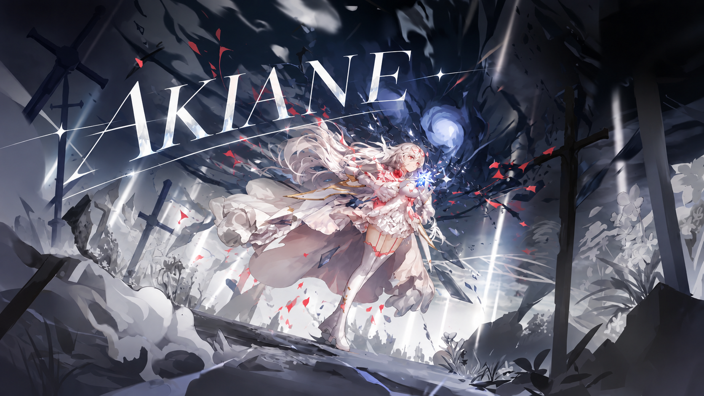
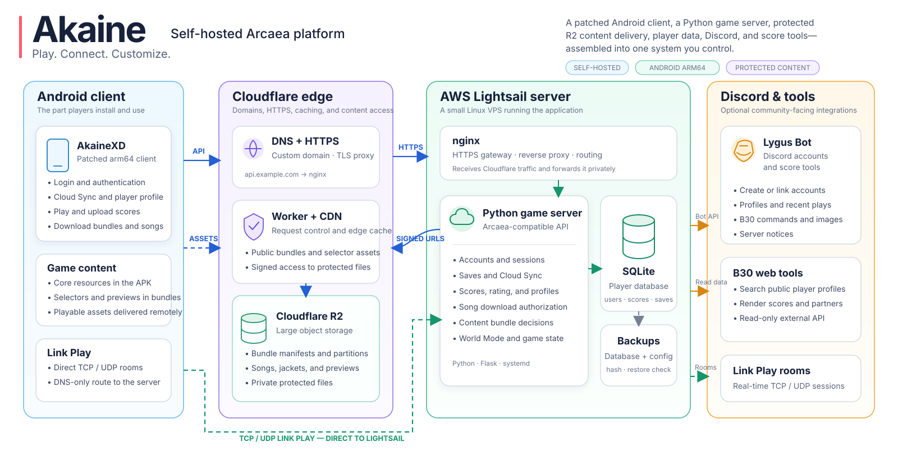

# Akaine 7.3.1

[English](README.md) | Tiếng Việt

  
  
  
  
   
  
  
  

  <strong><a href="docs/guide/vi/06-build-android-client.md">Chuẩn bị file client</a></strong> ·
  <a href="docs/guide/vi/README.md">Bắt đầu hướng dẫn</a> ·
  <a href="https://discord.gg/9BBXhX7DkN">Discord</a>

Akaine cung cấp mã nguồn công khai và hướng dẫn cho người mới muốn tự dựng
game server và chuẩn bị đầu vào cho client Android.

| Bạn muốn làm gì | Bắt đầu ở đâu |
| --- | --- |
| Chuẩn bị client gốc | [Kiểm và gộp XAPK Arcaea 7.3.1 ARM64](docs/guide/vi/06-build-android-client.md) |
| Tự dựng server | [Hướng dẫn từ máy trắng](docs/guide/vi/) |
| Xem phần chuyển sang 7.3.1 | [Mã patch native, Android và CLI](patches/arcaea-7.3.1-arm64/). Bản build độc lập 7.3.1 vẫn đang chờ hoàn thiện. |

**Nếu bắt đầu từ số 0, kiểm ba đầu vào trước khi thuê VPS:**

1. **Chỉ chuẩn bị client gốc:** tải XAPK ARM64 7.3.1 và làm theo chương client. Kết quả là file `merged.apk` gốc.
2. **Để self-host:** xin [bộ nội dung 7.3.1 đã chuẩn bị](docs/guide/vi/04-private-resources.md) từ nguồn được phép. Cần manifest, các phần bundle, danh mục và thư mục nhạc tải từng bài.
3. **Để chơi:** cần APK Akaine 7.3.1 đã áp patch, ký và cấu hình cho hostname của bạn. Repo hiện cung cấp mã patch và công cụ chuẩn bị XAPK; bước tạo APK Akaine hoàn chỉnh chưa có lệnh public.

## Tính năng

### Server

| Tính năng | Khả năng hỗ trợ |
| --- | --- |
| Tài khoản | Đăng ký, đăng nhập, phiên đăng nhập và giới hạn tần suất đăng nhập/đăng ký. |
| Điểm số và Potential | Gửi/kiểm tra điểm, lịch sử chơi, Potential theo Best 50 và xếp hạng bài. |
| Bạn bè | Danh sách bạn bè, thêm/xóa bạn và so sánh điểm. |
| Cloud Sync | Upload/download dữ liệu lưu và chính sách cấp nội dung chung. |
| World Mode | Bản đồ, thể lực, tiến trình và phần thưởng. |
| Nhân vật | Sở hữu, cấp độ, thức tỉnh và các kỹ năng được hỗ trợ. |
| Course Mode | Tiến trình thử thách, kết quả và phần thưởng hoàn thành. |
| Bài hát và pack | Danh mục mở rộng, sở hữu bài/pack và mở khóa bằng tiền tệ trong game. |
| Quà và nhiệm vụ | Quà tặng, mã đổi thưởng và nhiệm vụ tân thủ cơ bản. |
| Phân phối nội dung | Cập nhật bundle trong game, tải từng bài, kiểm tra file tải và chart mã hóa AKFC. |
| Quản trị | Web admin, API phân quyền, công cụ tài khoản/nội dung và log điểm/Potential. |
| Discord bot | Tạo/liên kết tài khoản, hồ sơ, lượt chơi gần đây, ảnh B30 và xếp hạng người chơi. |

**Lưu ý hỗ trợ:** Boost World Mode và một số kỹ năng nhân vật có thể khác game
chính thức. Có mã nguồn phòng chơi/matchmaking Link Play, nhưng cần thiết lập
riêng và kiểm tra tương thích với client.

Cài đặt: [game server](docs/guide/vi/05a-install-game-server.md) ·
[Discord bot](docs/guide/vi/05b-discord-bot.md) ·
[content bundle](docs/guide/vi/07-build-release-content-bundle.md).

### Client Android

| Tính năng | Khả năng hỗ trợ |
| --- | --- |
| Fan chart native | Chơi chart tùy chỉnh bằng engine của game, hỗ trợ chart mã hóa AKFC. |
| Thư viện Mod | Mục riêng cho nội dung tùy chỉnh và danh mục pack mở rộng. |
| Chọn bài | Tìm kiếm, chọn độ khó, sắp xếp, phân nhóm và lọc bài. |
| Nhân vật và kỹ năng | Chọn nhân vật, sử dụng hoặc phong ấn các skill native được hỗ trợ. |
| Anomaly Replay | Bật/tắt replay cho các cảnh anomaly native được hỗ trợ. |
| Dịch vụ online | Đăng nhập server riêng và Cloud Sync. |
| CLI qua ADB | Đọc trạng thái, điều khiển menu/gameplay/hướng dẫn đã nhận diện bằng lệnh, không cần click tọa độ hoặc quét ảnh. |
| Chẩn đoán | Log sự kiện native, đọc trạng thái và xuất log/ảnh chụp màn hình. |

Sử dụng: [build client](docs/guide/vi/06-build-android-client.md) ·
[lệnh CLI (tiếng Anh)](docs/guide/06a-semantic-cli.md) ·
[thêm fan chart native](docs/guide/vi/09-add-fan-chart.md).

**Tương thích:** Fan chart cần đúng định dạng native được hỗ trợ; chưa có runtime
ArcCreate. CLI chỉ xử lý các bước hướng dẫn đã nhận diện.

## Bạn sẽ dựng được gì

Sau khi hoàn thành các chương, bạn sẽ có:

- một Linux server chạy trên Amazon Lightsail
- một tên miền được Cloudflare bảo vệ
- private-server API truy cập qua HTTPS
- kho riêng để lưu bundle và file bài hát
- gói Android gốc 7.3.1 đã được xác minh và gộp từ APKPure
- Discord bot để quản lý tài khoản và công cụ score
- quy trình sao lưu và khôi phục

Để đăng nhập từ game, bạn cần APK Akaine 7.3.1 đã build cho đúng hostname server.

## Cấu trúc repo

- [Bộ build Android](akaine_build/) và [patch theo phiên bản](patches/) dùng để chuẩn bị file gốc và tham khảo source port. Mã patch dùng chung nằm ở [patches/shared](patches/shared/).
- [Semantic CLI](akaine_cli/) điều khiển client đã cài.
- [Server](server/) cung cấp API game. Xem cách cài trong [hướng dẫn](docs/guide/vi/).

## Bắt đầu hướng dẫn

- [Chuẩn bị XAPK Android](docs/guide/vi/06-build-android-client.md) nếu bạn đã có công cụ và file đầu vào.
- [Tự dựng server](docs/guide/vi/) nếu bạn bắt đầu từ đầu.

1. [Tìm hiểu hệ thống hoạt động như thế nào](docs/guide/vi/01-architecture.md).
2. [Tạo cloud server và kết nối tên miền](docs/guide/vi/02-cloud-domain.md).
3. [Chuẩn bị máy Windows](docs/guide/vi/03-workstation.md).
4. [Nhận và kiểm tra bộ tài nguyên riêng](docs/guide/vi/04-private-resources.md).
5. [Cấu hình R2](docs/guide/vi/05-cloudflare-content.md), [cài game server](docs/guide/vi/05a-install-game-server.md), [chạy Discord bot tùy chọn](docs/guide/vi/05b-discord-bot.md) và [thiết lập backup](docs/guide/vi/05c-backup-recovery.md).
6. [Build, ký và kiểm thử client Android](docs/guide/vi/06-build-android-client.md).
7. [Phát hành bundle 7.3.1 đã chuẩn bị](docs/guide/vi/07-build-release-content-bundle.md).
8. [Đọc kinh nghiệm và lỗi đã gặp khi xây dựng Akaine](docs/guide/vi/08-lessons-and-failures.md).
9. [Thêm fan chart và đặt nó vào một pack](docs/guide/vi/09-add-fan-chart.md).

Hãy đọc từ chương một và làm theo đúng thứ tự. Mỗi chương phía sau giả định
rằng bạn đã hoàn thành các bước kiểm tra của chương trước.

## Tài nguyên riêng

Tải client chưa sửa từ link APKPure trong chương 6. Nhận content catalogue,
đầu vào AKFC và game content tương ứng qua kênh riêng từ chủ dự án hoặc một
nguồn được ủy quyền. Bộ tài nguyên riêng có manifest để kiểm tra từng file
trước khi sử dụng.

## Ghi công

Akaine ghi công
[Lost-MSth/Arcaea-server](https://github.com/Lost-MSth/Arcaea-server) như một
nguồn tham khảo upstream cho phần server.

## Giấy phép và quyền sở hữu

Những phần mã nguồn thuộc Akaine được phát hành theo giấy phép MIT. Mã nguồn
của bên thứ ba tiếp tục sử dụng giấy phép gốc của nó. Giấy phép MIT không cấp
quyền phân phối lại game client thương mại, âm nhạc, chart, artwork hoặc tài
sản khác thuộc sở hữu của bên thứ ba.
