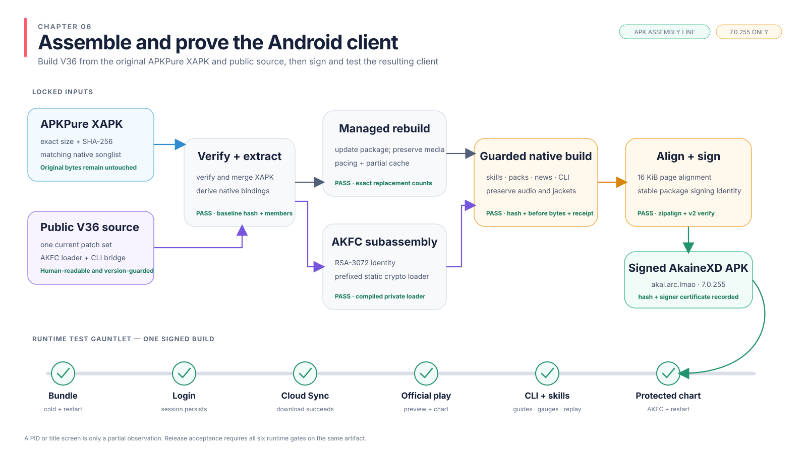

# Build V36 from the original APKPure package

English | [Tiếng Việt](vi/06-build-android-client.md)

Prepare the inputs once, then run one build command. It verifies and merges
the original APKPure package, applies the current V36 changes, compiles the
runtime, and aligns and signs your APK. No prepatched Akaine APK is an input.

This chapter supports only Arcaea **7.0.255 (`1209852`), arm64-v8a**.
Do not substitute another version or the armeabi-v7a download.



V36 includes the semantic CLI, first-run guide handling, character-skill fixes,
anomaly replay controls, Mod, dynamic packs, latest-ten news and guarded bundle
partial caching. Original music and jackets are preserved. Content bundles
remain separate from the APK; this command does not publish or activate them.

The included routes still use the published Akaine production hosts. Your own
domain needs a separately verified native route change; chapter 5a's server
check does not change client routes. ANGLE, Vulkan and unfinished loading
experiments are outside this build.

## 1. Open the prepared workstation

Use an interactive PowerShell window and keep it open for this chapter:

```powershell
$ErrorActionPreference = "Stop"
$repoRoot = [Environment]::GetEnvironmentVariable("AKAINE_REPO_ROOT", "User")
$kitRoot = [Environment]::GetEnvironmentVariable("AKAINE_KIT_ROOT", "User")
$python = Join-Path $repoRoot ".venv\Scripts\python.exe"
Set-Location $repoRoot
Get-Item $python, $kitRoot
& $python scripts\build_android_client.py --help
if ($LASTEXITCODE -ne 0) { throw "Client builder is unavailable." }
```

The paths come from chapters 3 and 4. The help command must show the inputs
used below. Stop and finish workstation setup if a required tool is missing.

## 2. Download and verify the original package

Download the **arm64-v8a XAPK** from the
[APKPure 7.0.255 page](https://apkpure.net/arcaea/moe.low.arc/download/7.0.255).
XAPK is the complete download: base, arcassets, arm64, English and mdpi modules.
Do not extract and supply only `moe.low.arc.apk`; that base APK is incomplete.

```powershell
$source = Get-Item -LiteralPath (Read-Host "Full path to the original APKPure 7.0.255 arm64 XAPK")
$expectedSourceHash = "459bb01f8357dde82b13a817d4dd5dbf81e7a70d0805cc0d5f1aebde36fa2b7a"
$sourceHash = (Get-FileHash -Algorithm SHA256 -LiteralPath $source.FullName).Hash.ToLowerInvariant()
if ($source.Length -ne 1219427332 -or $sourceHash -ne $expectedSourceHash) {
    throw "Wrong APKPure package. Stop here; do not change the expected hash."
}
$source | Select-Object Name, Length
$sourceHash
```

Both size and SHA-256 must match. The builder checks them again and merges the
modules itself. Its verified merged APK is 1,206,740,473 bytes, SHA-256
`746dd90c2efac21fc88ffd032e5a71c78c0955766477382c7f48ece87e23026e`.
This is the intermediate APK the builder produces, before applying V36.

## 3. Select tools, content keys and signing identity

Use Java 17 and Windows NDK `28.2.13676358`. Download
[APKEditor 1.4.9](https://github.com/REAndroid/APKEditor/releases/tag/V1.4.9)
and select the verified jadx all-in-one JAR and Android Build-Tools from your
workstation/kit instructions:

```powershell
$ndk = Get-Item -LiteralPath (Read-Host "Full path to Android NDK 28.2.13676358")
$java = Get-Item -LiteralPath (Read-Host "Full path to Java 17 java.exe")
$apkeditor = Get-Item -LiteralPath (Read-Host "Full path to APKEditor-1.4.9.jar")
$jadx = Get-Item -LiteralPath (Read-Host "Full path to the matching jadx all-in-one JAR")
$d8 = Get-Item -LiteralPath (Read-Host "Full path to Android Build-Tools d8.jar")
$buildTools = Get-Item -LiteralPath (Read-Host "Full path to Android SDK Build-Tools")
$javac = Join-Path $java.DirectoryName "javac.exe"
$keytool = Join-Path $java.DirectoryName "keytool.exe"
$apksigner = Join-Path $buildTools.FullName "apksigner.bat"
$aapt = Join-Path $buildTools.FullName "aapt.exe"
Get-Item $javac, $keytool, $apksigner, $aapt, (Join-Path $buildTools.FullName "zipalign.exe")
$editorHash = (Get-FileHash -Algorithm SHA256 -LiteralPath $apkeditor.FullName).Hash.ToLowerInvariant()
if ($apkeditor.Length -ne 7733037 -or $editorHash -ne "a9cd40df818845456be6d696de6110c89edf4b0a0580cb83438ed6b25a366e67") {
    throw "APKEditor does not match the verified 1.4.9 release."
}
& $java.FullName -version
if ($LASTEXITCODE -ne 0) { throw "Java failed." }
```

The NDK folder contains `toolchains`; the Build-Tools folder contains
`zipalign.exe`, `apksigner.bat` and `aapt.exe`. `d8.jar` normally sits inside
its `lib` folder. Java's folder must also contain `javac.exe` and `keytool.exe`.
Do not rename an unrelated JAR to make it look like the requested tool.

Select the catalogue and AKFC files verified in [chapter 4](04-private-resources.md):

```powershell
$songlist = Get-Item -LiteralPath (Read-Host "Full path to the verified native songlist JSON")
$keyHeader = Get-Item -LiteralPath (Read-Host "Full path to the matching private embedded_key.h")
$crypto = Get-Item -LiteralPath (Read-Host "Full path to the arm64 prefixed BoringSSL static archive")
Get-Item $songlist.FullName, $keyHeader.FullName, $crypto.FullName | Select-Object Name, Length
```

The native `songlist` supplies the CLI catalogue; server metadata is not a
substitute. The AKFC header must match the existing encrypted charts. **Do not
generate a new chart key for an existing catalogue.** Keep the header outside
Git; the compiler uses it without printing its contents.

### Only if creating a new server's chart key

Skip this block for existing Akaine charts. A new server may generate one
RSA-3072 pair and encrypt its charts with the matching public key:

```powershell
$keyFolder = [IO.Path]::GetFullPath((Read-Host "Private folder for a new server's AKFC keys"))
$privateKey = Join-Path $keyFolder "akfc-private.pem"
$publicKey = Join-Path $keyFolder "akfc-public.pem"
$newKeyHeader = Join-Path $keyFolder "embedded_key.h"
if (-not (Test-Path $privateKey) -and -not (Test-Path $publicKey)) {
    & $python scripts\generate_akfc_keypair.py --private-key $privateKey --public-key $publicKey
    if ($LASTEXITCODE -ne 0) { throw "AKFC key generation failed." }
} elseif (-not (Test-Path $privateKey) -or -not (Test-Path $publicKey)) {
    throw "Only half of the AKFC pair exists. Restore its matching partner."
}
& $python scripts\generate_akfc_key_header.py --private-key $privateKey --output $newKeyHeader
if ($LASTEXITCODE -ne 0) { throw "AKFC header generation failed." }
$keyHeader = Get-Item -LiteralPath $newKeyHeader
```

This reuses a complete pair and stops if only one half exists. It does not
change the key used by already encrypted charts.

### Only if the static crypto archive is missing

Install CMake and Ninja through Android Studio SDK Tools, then use the helper:

```powershell
$env:ANDROID_NDK_ROOT = $ndk.FullName
$cryptoWork = [IO.Path]::GetFullPath((Read-Host "New private working directory for the crypto build"))
$cryptoOutput = Join-Path $cryptoWork "libakfc-crypto.a"
& $python scripts\build_boringssl_android.py --work $cryptoWork --output $cryptoOutput
if ($LASTEXITCODE -ne 0) { throw "BoringSSL build failed." }
$crypto = Get-Item -LiteralPath $cryptoOutput
```

It downloads and compiles BoringSSL with the `akfc_` symbol prefix. A temporary
archive from a failed command is not a usable build input.

### Choose the Android signing key

The Android keystore proves who signed the app. It is separate from the AKFC
chart key. Reuse the existing keystore and alias when updating an installation.
Create a key only for a new signing identity:

```powershell
$keystore = [IO.Path]::GetFullPath((Read-Host "Full path to your private Android keystore"))
$keyAlias = Read-Host "Signing-key alias"
if (-not (Test-Path $keystore)) {
    New-Item -ItemType Directory -Force (Split-Path -Parent $keystore) | Out-Null
    & $keytool -genkeypair -keystore $keystore -alias $keyAlias -keyalg RSA -keysize 4096 -validity 10000
    if ($LASTEXITCODE -ne 0) { throw "Signing-key generation failed." }
}
Get-Item -LiteralPath $keystore
```

Keytool requests passwords privately. Keep the keystore and its backup outside
Git. Losing it prevents updates over installations signed with that key.

## 4. Build and sign with one command

Choose a new output directory outside the repository. The build can take several
minutes. Leave the PowerShell window open, answer the private password prompts
when signing starts, and stop on the first error:

```powershell
$buildOutput = [IO.Path]::GetFullPath((Read-Host "New output directory outside the repository"))
if (Test-Path $buildOutput) { throw "Choose a new output directory." }
$arguments = @(
    "--source", $source.FullName,
    "--songlist", $songlist.FullName,
    "--ndk", $ndk.FullName,
    "--java", $java.FullName,
    "--apkeditor", $apkeditor.FullName,
    "--jadx", $jadx.FullName,
    "--d8", $d8.FullName,
    "--crypto", $crypto.FullName,
    "--key-header", $keyHeader.FullName,
    "--output", $buildOutput,
    "--keystore", $keystore,
    "--key-alias", $keyAlias,
    "--build-tools", $buildTools.FullName
)
& $python scripts\build_android_client.py @arguments
if ($LASTEXITCODE -ne 0) { throw "V36 build failed. Keep the first error; do not install its output." }
$signedApk = Join-Path $buildOutput "Akaine-V36.apk"
$receipt = Get-Content (Join-Path $buildOutput "BUILD_RECEIPT.json") -Raw | ConvertFrom-Json
if ($receipt.status -ne "APKPURE_TO_V36_SOURCE_BUILD_VERIFIED" -or $receipt.signed -ne $true) {
    throw "The build did not complete and sign successfully."
}
Get-Item -LiteralPath $signedApk | Select-Object Name, Length
```

The command produces `Akaine-V36.apk` and `BUILD_RECEIPT.json`. It checks the
original input and patch preimages, compiles current native/Android code,
preserves unrelated APK files, then aligns and signs with your key. You do not
run individual native, DEX or checkpoint scripts.

Passwords are requested privately, not passed in command arguments. Do not
put them in a script or build log.

If the build stops, keep its directory and first error for inspection. Use a
new output directory for the next attempt rather than mixing partial outputs.

Check the signed result independently:

```powershell
& $apksigner verify --verbose --print-certs $signedApk
if ($LASTEXITCODE -ne 0) { throw "APK signature verification failed." }
& $aapt dump badging $signedApk | Select-String "package:|application-label:|launchable-activity:"
if ($LASTEXITCODE -ne 0) { throw "APK package inspection failed." }
Get-FileHash -Algorithm SHA256 -LiteralPath $signedApk
```

The signature check must succeed, including APK Signature Scheme v2. Badging
must show package `akai.arc.lmao`, label `AkaineXD`, version `7.0.255`, code
`1209852` and activity `low.moe.AppActivity`. Record the signer certificate
digest for later updates. Your own signer produces a different final APK hash.

## 5. Install and check the app

Connect the intended device or emulator and read its exact serial:

```powershell
adb devices -l
$serial = Read-Host "Exact device serial shown above"
adb -s $serial shell pm path "akai.arc.lmao"
```

Proceed only when ADB lists it as `device`. Resolve `unauthorized` or `offline`
first. A `package:` result means Akaine is already installed.

For a fresh installation:

```powershell
adb -s $serial install $signedApk
if ($LASTEXITCODE -ne 0) { throw "Fresh installation failed." }
```

For an update signed with the same certificate:

```powershell
adb -s $serial install -r $signedApk
if ($LASTEXITCODE -ne 0) { throw "Install-over failed. Check the signer before doing anything else." }
```

Do not uninstall automatically after `INSTALL_FAILED_UPDATE_INCOMPATIBLE`.
Uninstalling deletes local data. Find the matching signer or explicitly back
up and choose a fresh installation.

Launch and read semantic state:

```powershell
adb -s $serial shell am start -n "akai.arc.lmao/low.moe.AppActivity"
if ($LASTEXITCODE -ne 0) { throw "Android launch request failed." }
& $python scripts\akaine_cli\akaine.py --serial $serial status
if ($LASTEXITCODE -ne 0) { throw "Client bridge is not ready. Inspect the app and logs." }
& $python scripts\akaine_cli\akaine.py --serial $serial ui list
if ($LASTEXITCODE -ne 0) { throw "Client UI state read failed." }
```

The CLI uses game callbacks rather than screen coordinates or image scanning.
A launch request does not prove the app stayed alive. Inspect the app and logs
when the bridge is not ready. The [CLI reference](06a-semantic-cli.md) covers
recognized first-run guides, song/character controls and unknown outcomes.

Before distributing an APK, test it with an isolated account and matching content:

1. Reach the title screen and download the configured bundle without a crash/loop.
2. Sign in, Cloud Sync Download, restart, and confirm login and downloads persist.
3. Complete recognized guides; select packs, songs, filters and characters.
4. Check Mod placement, distinctive skill gauges, and replay disabled/enabled.
5. Play an official chart and a native fan chart; check music, jackets and saved results.

Build/signature checks do not establish gameplay compatibility or performance
on every device. No command above deploys a server or publishes a bundle.

Next: [Build, verify and release a content bundle](07-build-release-content-bundle.md).
