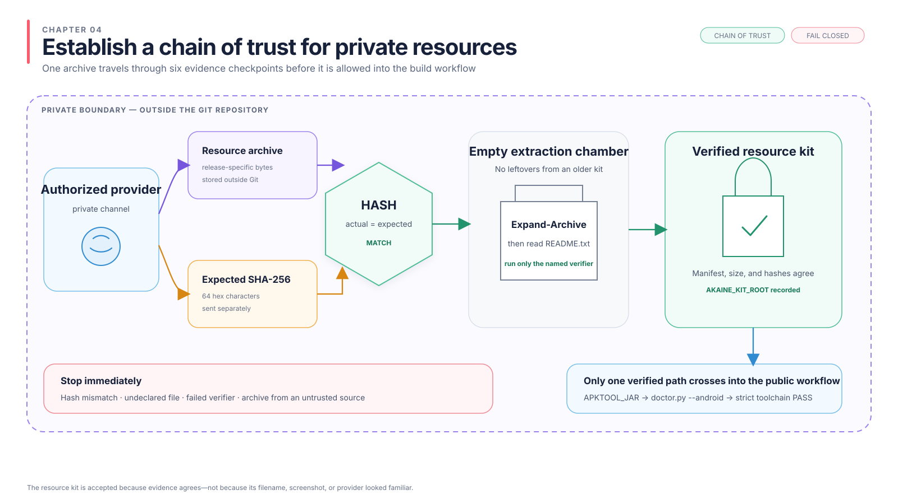

# Nhận và xác minh bộ tài nguyên riêng

[English](../04-private-resources.md) | Tiếng Việt

GitHub chứa mã nguồn và hướng dẫn này. Tải client gốc qua link APKPure trong
chương 6. Bộ tài nguyên riêng cung cấp content, native catalogue và đầu vào
AKFC tương ứng. NDK, Java và công cụ Android được cài tại đường dẫn do bạn
chọn; không cần APK Akaine đã patch.



## Nhận bộ tài nguyên

Nhận bộ tài nguyên riêng và SHA-256 dự kiến từ chủ dự án qua kênh riêng. Không yêu cầu
hoặc đăng tài nguyên này trong GitHub Issue, Discussion, kênh server công khai hay group
chat.

Tải file nén về một vị trí bên ngoài Git repository.

Nhà cung cấp phải gửi riêng hai thứ qua kênh riêng: file nén và giá trị SHA-256 gồm 64
ký tự. Filename, file size hoặc screenshot không thay thế được hash.

## Kiểm tra file nén đã tải

Nhà cung cấp sẽ gửi SHA-256 dự kiến. Chạy:

```powershell
$kitArchive = Get-Item (Read-Host "Full path to the downloaded kit archive")
$expectedKitHash = (Read-Host "Expected 64-character SHA-256 from the provider").Trim().ToLowerInvariant()
$actualKitHash = (Get-FileHash -Algorithm SHA256 $kitArchive.FullName).Hash.ToLowerInvariant()

if ($expectedKitHash -notmatch '^[0-9a-f]{64}$') {
    throw "The expected SHA-256 is not 64 hexadecimal characters."
}
if ($actualKitHash -ne $expectedKitHash) {
    throw "The private resource archive does not match its expected SHA-256."
}

$kitArchive | Select-Object Name, Length, FullName
$actualKitHash
```

So sánh hash 64 ký tự hoàn chỉnh với giá trị mong đợi. Chữ hoa chữ thường không thành
vấn đề; mọi ký tự phải khớp nhau. Nếu nó khác, hãy xóa file và yêu cầu nhà cung cấp thay
thế đã được xác minh. Không giải nén hoặc chạy nó.

`Get-Item` dừng nếu file đã chọn không tồn tại. `Get-FileHash` đọc toàn bộ file nén nên
có thể mất một lúc. Hai block `if` biến hash thành stop gate thay vì yêu cầu so sánh
bằng mắt.

## Trích xuất và xác minh nội dung

Sau khi hash lưu trữ khớp, hãy chọn nơi giải nén nó:

```powershell
$kitRoot = Read-Host "Full path for the extracted kit"
$kitRoot = [IO.Path]::GetFullPath($kitRoot)

if (Test-Path $kitRoot) {
    if (Get-ChildItem -Force $kitRoot | Select-Object -First 1) {
        throw "The extraction folder is not empty. Choose a new folder."
    }
} else {
    New-Item -ItemType Directory -Force $kitRoot | Out-Null
}

Expand-Archive `
  -LiteralPath $kitArchive.FullName `
  -DestinationPath $kitRoot

[Environment]::SetEnvironmentVariable("AKAINE_KIT_ROOT", $kitRoot, "User")
Get-Item (Join-Path $kitRoot "README.txt")
```

Quy tắc folder rỗng ngăn file còn lại từ bộ cũ bị nhầm là file hiện tại.
`Expand-Archive` giải nén mà không sửa file đã tải. Environment variable ghi lại folder
đã chọn cho chương sau. Lệnh cuối phải tìm thấy `README.txt`.

Bộ tài nguyên có manifest và script kiểm tra. Chạy command ghi trong `README.txt`. Kết
quả phải xác nhận mọi file được khai báo đều tồn tại, đúng kích thước và đúng SHA-256.

Mở instruction mà chưa chạy thứ gì trước:

```powershell
Get-Content (Join-Path $kitRoot "README.txt")
```

Chỉ chạy verification command được gọi tên trong đó. Không chạy executable hoặc
maintenance script chỉ vì nó có mặt trong file nén.

Không tiếp tục nếu quá trình xác minh báo cáo file bị thiếu hoặc không khớp.

## Kiểm đầu vào client V36

Trước chương 6, xác định những file đã kiểm này trong hướng dẫn của kit:

- Native `songlist` JSON khớp catalogue content. Server metadata là file khác,
  không thay thế được nó.
- Private AKFC key header tương ứng với protected chart. Giữ header ngoài
  repository; nó được truyền trực tiếp cho native compiler.
- Static BoringSSL archive arm64 có symbol prefix `akfc_`, hoặc hướng dẫn
  build nó bằng public helper.
- Đúng jadx all-in-one JAR và Android Build-Tools `d8.jar`, cùng thông tin
  xác minh của chúng. Java 17 và NDK `28.2.13676358` được chọn ở chương 6.

XAPK APKPure gốc và APKEditor được tải riêng theo chương 6; chương đó có
hash chính xác của chúng. Kit không cần APK Akaine, local path map của người
phát triển, SDK directory được copy, payload `.so`/`.dex` cuối đã patch hay
Android keystore của operator khác. Chương 6 nhận đường dẫn đầu vào tường
minh rồi build từ client gốc và source công khai.
Không tạo AKFC key mới khi dùng catalogue hiện có: client đó sẽ không giải mã
được những chart đã mã hóa.

## Giữ bộ tài nguyên riêng tư

- Không commit bộ tài nguyên vào Git hoặc GitHub.
- Không upload nó lên public file server.
- Không phân phối lại nó trừ khi bạn được sự cho phép của mọi chủ sở hữu có liên quan.
- Không lưu trữ credentials sản xuất hoặc cơ sở dữ liệu người chơi trong cùng một
  thư mục.
- Có quyền truy cập bộ tài nguyên không đồng nghĩa với quyền phân phối lại nội dung.

## Kiểm tra công việc của bạn

- Hash lưu trữ khớp với giá trị mong đợi từ nhà cung cấp.
- Kiểm tra manifest sau giải nén đã pass.
- Bộ tài nguyên nằm ngoài Git repository.
- `AKAINE_KIT_ROOT` trỏ tới thư mục đã giải nén và xác minh.

Các chương sau sẽ chỉ rõ file nào trong bộ tài nguyên được sử dụng. Đừng tự đoán mục
đích hoặc chạy script chưa được hướng dẫn nhắc tới.
