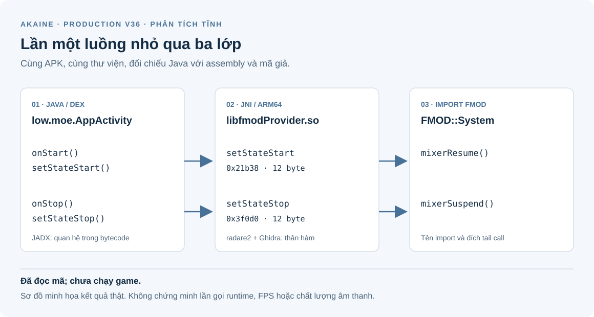
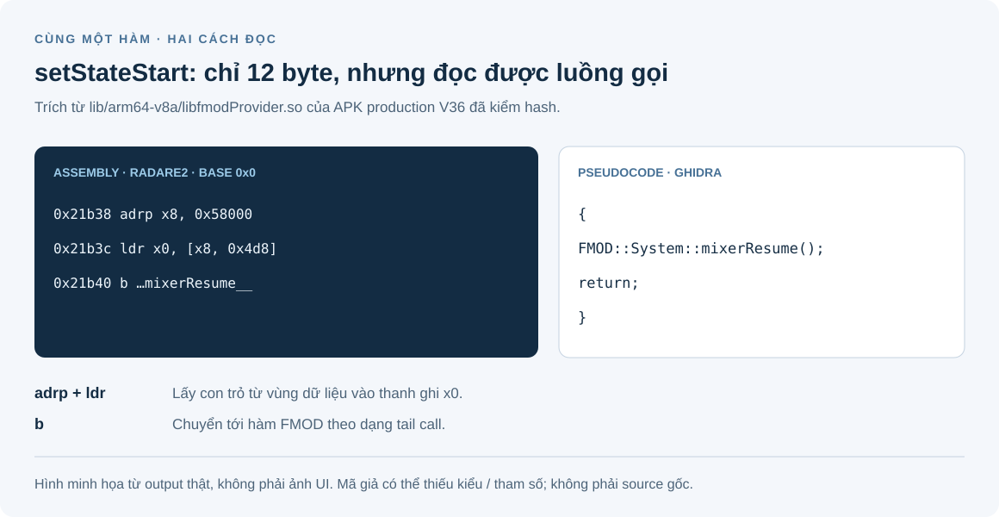

# Phụ lục A: đọc APK V36 mà chưa cần chạy game

[Mục lục tiếng Việt](README.md)

Phụ lục này dành cho người mới: lấy một thư viện `.so` từ **APK production V36
thật**, tìm một hàm, đọc lệnh máy rồi đối chiếu với mã giả. Bạn có thể theo bằng
giao diện **Ghidra** hoặc dòng lệnh **radare2**. Hai cách này đều là **phân tích
tĩnh**; không cần emulator, root, đăng nhập hay kết nối game server.

Đây là phần đọc thêm, không phải bước bắt buộc để build Akaine. Chỉ thực hiện
trên file bạn có quyền phân tích. APK, `.so` và project phân tích nằm ngoài Git.

## 1. Ta đang muốn biết điều gì?

Ví dụ cụ thể: **hai hàm `setStateStart` và `setStateStop` làm gì ở phía native?**
Ta sẽ lần từ `low.moe.AppActivity` trong DEX đến hai hàm JNI trong
`libfmodProvider.so`, rồi thấy chúng chuyển tiếp đến `mixerResume` và
`mixerSuspend` của FMOD. Chưa chạy game nên chưa kết luận được thời điểm gọi
thực tế, độ trễ hay chất lượng âm thanh.



*Sơ đồ được vẽ từ kết quả phân tích thật; không phải screenshot IDA/Ghidra.
Các mũi tên là quan hệ trong mã, không phải trace ghi khi game chạy.*

Một vài từ cần biết trước:

| Từ | Hiểu đơn giản |
| --- | --- |
| APK | Gói cài Android, có thể đọc cấu trúc ZIP của nó. |
| DEX | Bytecode Android; JADX có thể dựng lại dạng Java để đọc. |
| `.so` | Thư viện native; ví dụ này chứa mã máy ARM64 trong định dạng ELF. |
| JNI | Cầu nối giữa Java và native. Tên export có thể chỉ ra class/method tương ứng. |
| Export / import | Tên hàm thư viện cung cấp / tên hàm thư viện cần lấy từ nơi khác. |
| Disassembly | Lệnh máy được hiển thị bằng assembly, như `ldr`, `b`. |
| Pseudocode | Mã giả do decompiler dựng lại; không phải source C/C++ gốc. |

## 2. Chuẩn bị đúng file và công cụ

Lượt demo ngày **02/11/2026** dùng:

- **Ghidra 12.1.3**, chạy với JDK 21, để phân tích native và dựng mã giả.
- **radare2 6.2.0**, có `rabin2.exe` và `radare2.exe`, để kiểm tra bằng CLI.
- **JADX 1.5.6**, tùy chọn, để lần thêm phía Java trong APK.
- Python và PowerShell như [chương 3](03-workstation.md).

Lấy công cụ từ dự án gốc: [Ghidra](https://github.com/NationalSecurityAgency/ghidra),
[radare2](https://github.com/radareorg/radare2), [JADX](https://github.com/skylot/jadx).
Tải bản Windows đã build; làm theo yêu cầu Java trong bản phát hành bạn dùng.
Không cần cài IDA để theo demo này. IDA cũng có thể đọc assembly và, với
decompiler phù hợp, dựng mã giả. Kết quả demo được xuất bằng Ghidra headless;
các bước GUI bên dưới giúp bạn mở cùng file để xem Listing và Decompiler.

| Đầu vào | Giá trị đã kiểm |
| --- | --- |
| APK | `AkaineXD-7.0.255-prod-v36-20261027.apk` |
| SHA-256 APK | `a8b243c59adc527e8fa1ada27a0394979234d345b2063da40fcc2fbcc2ffc5fd` |
| File trong APK | `lib/arm64-v8a/libfmodProvider.so` |
| Kích thước `.so` | `328392` byte |
| SHA-256 `.so` | `67e46d97052311ac5bb9c4adca6c62746feea3649d68750c8bff061cc7755ec0` |
| Định dạng | ELF64, ARM AArch64, little-endian, Android |

Đừng lấy APK upstream chưa patch hoặc một bản staging rồi dùng địa chỉ của
demo này. Khác hash là khác đầu vào, kể cả khi tên phiên bản giống nhau.

### Bước 1: kiểm APK

Mở **PowerShell trên Windows**. Dùng một thư mục mới ngoài repository để lưu
kết quả. Các biến trong phụ lục dùng chung cửa sổ PowerShell này.

```powershell
$apk = (Resolve-Path -LiteralPath (Read-Host "Full path to the production V36 APK")).Path
$analysis = [IO.Path]::GetFullPath((Read-Host "New analysis folder outside the repository"))
if (Test-Path -LiteralPath $analysis) { throw "Choose a new analysis folder" }
if ((Get-FileHash -LiteralPath $apk -Algorithm SHA256).Hash.ToLowerInvariant() -ne
    'a8b243c59adc527e8fa1ada27a0394979234d345b2063da40fcc2fbcc2ffc5fd') {
    throw "This APK does not match the V36 demo"
}
New-Item -ItemType Directory -Path $analysis | Out-Null
```

`Get-FileHash` đọc file để tính dấu vân tay, không chạy APK. Nếu báo khác hash,
dừng và kiểm lại đầu vào; không cố dùng địa chỉ dưới đây cho file khác.

### Bước 2: chỉ lấy đúng `.so`

Không cần giải nén toàn bộ hình ảnh/nhạc trong APK. Chạy block này trong cùng
PowerShell; Python chỉ đọc đúng ZIP member đã nêu và ghi bản sao ra thư mục mới.

```powershell
@'
import sys, zipfile
from pathlib import Path
with zipfile.ZipFile(sys.argv[1]) as apk:
    data = apk.read('lib/arm64-v8a/libfmodProvider.so')
with (Path(sys.argv[2]) / 'libfmodProvider.so').open('xb') as output:
    output.write(data)
'@ | python - $apk $analysis
if ($LASTEXITCODE -ne 0) { throw "Extraction failed" }
$so = Join-Path $analysis 'libfmodProvider.so'
if ((Get-Item -LiteralPath $so).Length -ne 328392 -or
    (Get-FileHash -LiteralPath $so -Algorithm SHA256).Hash.ToLowerInvariant() -ne
    '67e46d97052311ac5bb9c4adca6c62746feea3649d68750c8bff061cc7755ec0') {
    throw "Extracted library does not match the demo"
}
```

Thành công nghĩa là có một `.so` đúng hash và kích thước. Nó chưa được nạp vào
game hay thực thi. Nếu lấy nhầm ABI, ví dụ `armeabi-v7a`, kết quả sẽ không khớp.

## 3. Cách thứ nhất: xem bằng giao diện Ghidra

1. Mở Ghidra bằng `ghidraRun.bat` trong thư mục đã giải nén.
2. Chọn **File → New Project → Non-Shared Project**. Lưu project trong thư mục
   phân tích ngoài repository, đặt tên `V36Demo`.
3. Chọn **File → Import File**, chọn `$so` — tức file `libfmodProvider.so`
   vừa lấy. Ghidra phải nhận là ELF, little-endian, AArch64 64-bit. Bản demo
   nhận language `AARCH64:LE:64:v8A`.
4. Import xong, mở file trong project để vào **CodeBrowser**. Khi được hỏi
   **Analyze?**, chọn **Yes** và chạy **Analyze** với cấu hình mặc định.
   Chờ phân tích xong trước khi đọc kết quả.
5. Trong **Symbol Tree → Exports**, tìm
   `Java_low_moe_AppActivity_setStateStart` và mở nó. Nếu không thấy Symbol
   Tree hoặc Decompiler, bật ở menu **Window**.
6. Đọc **Listing** để thấy assembly; đọc **Decompiler** để thấy mã giả của
   cùng hàm. Làm lại với `Java_low_moe_AppActivity_setStateStop`.

Nếu không có export hoặc decompiler báo lỗi, dừng để kiểm hash, kiến trúc và
trạng thái analysis. Không tự đặt tên cho một địa chỉ bất kỳ rồi coi là đã
tìm được đúng hàm.

Kết quả Ghidra đã xuất trên file thật:

```c
void Java_low_moe_AppActivity_setStateStart(void)
{
  FMOD::System::mixerResume();
  return;
}

void Java_low_moe_AppActivity_setStateStop(void)
{
  FMOD::System::mixerSuspend();
  return;
}
```

Đây là **mã giả nguyên dạng của decompiler**, kể cả chữ `void`. Công cụ có
thể chưa khôi phục đủ prototype JNI hoặc con trỏ `this` của C++; đừng copy
đoạn này thành source để build. Assembly bên dưới cho thấy nó có nạp một
con trỏ vào `x0` trước khi chuyển tới hàm FMOD.



*Hình minh họa dàn lại kết quả đã xuất bằng CLI/Ghidra headless, không phải
screenshot giao diện. Listing và Decompiler ở bước GUI hiển thị hai dạng
thông tin tương ứng.*

### Vì sao địa chỉ trên Ghidra và CLI có thể khác nhau?

Project Ghidra của lượt demo dùng image base `0x00100000`; radare2 đọc với base
`0x0`. Vì vậy cùng một hàm có thể hiện như bảng dưới:

| Hàm | Ghidra trong project demo | radare2 |
| --- | --- | --- |
| `setStateStart` | `0x00121b38` | `0x00021b38` |
| `setStateStop` | `0x0013f0d0` | `0x0003f0d0` |

Nếu Ghidra của bạn chọn base khác, ưu tiên tìm bằng **symbol**. Đây là địa
chỉ trong không gian phân tích của từng công cụ, không phải địa chỉ RAM đã
quan sát khi chạy. Cũng không được mặc định coi mọi địa chỉ là file offset;
cần xem mapping ELF khi muốn chuyển giữa chúng.

## 4. Cách thứ hai: kiểm bằng CLI

Trong cùng PowerShell, chỉ đường dẫn tới hai executable trong bản radare2
bạn đã giải nén. Không cần sửa PATH toàn máy.

```powershell
$rabin = (Resolve-Path -LiteralPath (Read-Host "Full path to rabin2.exe")).Path
$radare = (Resolve-Path -LiteralPath (Read-Host "Full path to radare2.exe")).Path
& $rabin -I $so
if ($LASTEXITCODE -ne 0) { throw "ELF inspection failed" }
```

`-I` xem thông tin ELF. Đầu ra demo gồm `bits 64`, `class ELF64`,
`machine ARM aarch64`, `os android`, `stripped true`. `stripped` không có
nghĩa mọi tên hàm đều biến mất: các export JNI vẫn còn trong file này.

Tìm export và import liên quan:

```powershell
& $rabin -E $so | Select-String 'Java_low_moe_AppActivity_setState'
& $rabin -i $so | Select-String 'mixerResume|mixerSuspend'
```

`-E` liệt kê export; `-i` liệt kê import. Phải thấy hai export `setStateStart`,
`setStateStop` và hai import FMOD tương ứng. Chỉ thấy tên import vẫn chưa
chứng minh hàm nào gọi nó; bước tiếp theo kiểm chính thân hàm.

```powershell
& $radare -q -e scr.color=0 -e bin.relocs.apply=true -c 's sym.Java_low_moe_AppActivity_setStateStart;af;pdf;s sym.Java_low_moe_AppActivity_setStateStop;af;pdf;q' $so
if ($LASTEXITCODE -ne 0) { throw "Disassembly failed" }
```

Ý nghĩa các phần:

- `-q`: bớt thông báo mở đầu; `scr.color=0`: tắt mã màu để dễ đọc/lưu.
- `bin.relocs.apply=true`: áp dụng relocation vào mô hình phân tích của
  radare2; không ghi lại file `.so` trên đĩa.
- `s sym.…`: tới symbol được chọn; `af`: phân tích hàm ở vị trí đó.
- `pdf`: in disassembly của hàm, **không phải tạo file PDF**.
- `q`: thoát. Không có `-w`, không có lệnh debug hay chạy chương trình.

Trích kết quả thực tế, lược header và comment tự suy đoán của công cụ:

```text
Java_low_moe_AppActivity_setStateStart
0x00021b38  a80100f0  adrp x8, 0x58000
0x00021b3c  006d42f9  ldr x0, [x8, 0x4d8]
0x00021b40  eca60014  b sym.imp.FMOD::System::mixerResume__

Java_low_moe_AppActivity_setStateStop
0x0003f0d0  c80000b0  adrp x8, 0x58000
0x0003f0d4  006d42f9  ldr x0, [x8, 0x4d8]
0x0003f0d8  8a310014  b sym.imp.FMOD::System::mixerSuspend__
```

Mỗi hàm chỉ dài **12 byte**, gồm ba lệnh ARM64:

1. `adrp` tính địa chỉ một trang dữ liệu.
2. `ldr` lấy con trỏ từ slot ở `0x584d8` vào thanh ghi `x0` trong cấu hình
   base `0x0` này. Kiểu đối tượng chính xác cần thêm phân tích.
3. `b` chuyển thẳng tới đích FMOD. Đây là dạng **tail call**; không cần một
   `ret` riêng ở cuối wrapper vì hàm đích sẽ trả về caller ban đầu.

Tên đích và lệnh chuyển điều khiển cùng có mặt là bằng chứng mạnh hơn việc
chỉ tìm thấy chữ `mixerResume` trong danh sách string. Đừng suy rộng rằng mọi
hàm của thư viện đều đơn giản hoặc đã được phân tích từ ví dụ này.

## 5. Tùy chọn: lần ngược lại phía Java bằng JADX

Để biết ai gọi hai hàm native, chỉ `.so` chưa cho đủ bức tranh. Dùng JADX
đọc class `low.moe.AppActivity` từ **cùng APK V36**:

```powershell
$jadx = (Resolve-Path -LiteralPath (Read-Host "Full path to jadx.bat")).Path
& $jadx -r -j 2 --single-class low.moe.AppActivity --single-class-output (Join-Path $analysis 'AppActivity.java') $apk
if ($LASTEXITCODE -ne 0) { throw "JADX did not finish successfully" }
Select-String -LiteralPath (Join-Path $analysis 'AppActivity.java') -Pattern 'loadLibrary\(this, "fmodProvider"|native void setState|setStateStart\(\);|setStateStop\(\);' -Context 2,2
```

`-r` bỏ giải mã resource; `-j 2` dùng hai worker; `--single-class` chỉ xuất
class cần đọc. Không cố khôi phục toàn bộ ứng dụng để trả lời một câu hỏi nhỏ.
Lượt demo xuất class thành công, không cần chạy APK.

Trong Java do JADX dựng lại, ta thấy:

- `onCreate()` nạp thư viện bằng
  `ReLinker.recursively().loadLibrary(this, "fmodProvider")`.
- Class khai báo `private native void setStateStart()` và `setStateStop()`.
- `onStart()` gọi `setStateStart()`; `onStop()` gọi `setStateStop()`.

Theo quy tắc tên JNI ở đây, `Java_low_moe_AppActivity_setStateStart` nối với
`low.moe.AppActivity.setStateStart`. Kết hợp Java và native cho ra sơ đồ ở
đầu phụ lục. Một số ứng dụng đăng ký JNI theo cách động nên không có export
dễ đọc như ví dụ này; không thể áp dụng cách tìm tên này cho mọi APK.

## 6. Chốt lại: ta đã biết và chưa biết gì?

**Đã kiểm từ file thật:** hash APK và `.so`, kiến trúc ARM64, export JNI,
thân hai wrapper, import/đích chuyển tới FMOD, và caller phía Java được
JADX dựng lại. Ghidra và radare2 cho kết quả cùng hướng.

**Chưa kiểm runtime:** các hàm có chạy ở một phiên game cụ thể không, thread
nào gọi chúng, trạng thái audio device, FPS hay chất lượng âm thanh. Muốn
trả lời các câu đó mới cần bước phân tích động — chạy app và quan sát.

AI có thể giúp tìm symbol, đọc assembly, đặt giả thuyết và so sánh kết quả.
Người đọc vẫn cần kiểm đầu vào và bằng chứng; tên hàm hay mã giả đẹp không
đảm bảo một kết luận đúng. Ví dụ này không phải khôi phục toàn bộ source,
giải mã tài nguyên hay patch APK.
